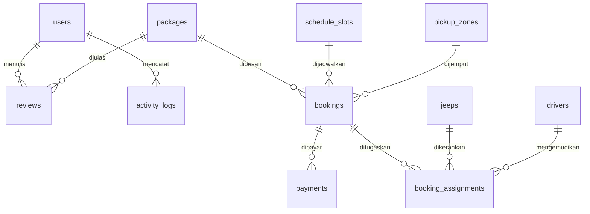

# Dokumentasi Basis Data (Database) – Jeep Wukirsari Adventure Tour

Dokumentasi ini menyajikan spesifikasi lengkap skema basis data MySQL (*MariaDB via XAMPP*) pada platform pemesanan Jeep Wukirsari, mencakup 19 tabel, tipe data, indeks, kunci utama (*Primary Key*), kunci asing (*Foreign Key*), serta hubungan antar entitas.

---

## 1. Diagram Relasi Entitas (Entity-Relationship Diagram)



---

## 2. Ringkasan 19 Tabel Basis Data

| No | Nama Tabel | Kategori | Fungsi Utama |
| :---: | :--- | :--- | :--- |
| 1 | `packages` | Bisnis Wisata | Menyimpan katalog paket tur (Short, Medium, Long, Sunrise), rute, dan harga sewa. |
| 2 | `schedule_slots` | Bisnis Wisata | Menyimpan jam sesi keberangkatan armada harian dan kapasitas maksimal jeep. |
| 3 | `pickup_zones` | Bisnis Wisata | Menyimpan zona jangkauan antar-jemput shuttle pangkalan dan tarif tambahan per jeep. |
| 4 | `bookings` | Transaksi Inti | Menyimpan data reservasi wisatawan, kode booking, jadwal, pax, armada, dan status. |
| 5 | `payments` | Transaksi Inti | Menyimpan catatan transaksi finansial (Midtrans VA/QRIS, transfer BPD DIY, cash loket). |
| 6 | `jeeps` | Operasional | Menyimpan inventaris armada mobil offroad 4x4 (nopol, model, status kesiapan). |
| 7 | `drivers` | Operasional | Menyimpan data sopir/pengemudi lokal paguyuban (nama, no HP, status aktif). |
| 8 | `booking_assignments`| Operasional | Tabel relasi penugasan (*dispatching*) unit jeep dan supir ke pesanan booking tertentu. |
| 9 | `users` | Autentikasi | Menyimpan akun pengguna (Admin Paguyuban dan Akun Wisatawan/Customer). |
| 10 | `reviews` | Interaksi | Menyimpan testimoni kepuasan, rating bintang (1–5), dan status persetujuan admin. |
| 11 | `activity_logs` | Audit Trail | Menyimpan log kronologis aksi sistem (booking baru, pelunasan kasir, penugasan). |
| 12 | `password_reset_tokens`| Keamanan | Menyimpan token hash untuk pemulihan kata sandi pengguna. |
| 13 | `sessions` | Session State | Menyimpan state sesi login pengguna HTTP. |
| 14 | `cache` | Kinerja | Menyimpan nilai cache sistem dan kunci atomic lock. |
| 15 | `cache_locks` | Kinerja | Menyimpan penguncian atomik untuk mencegah transaksi ganda (concurrency guard). |
| 16 | `jobs` | Antrean Task | Menyimpan antrean latar belakang (*asynchronous job queue*). |
| 17 | `job_batches` | Antrean Task | Menyimpan batch eksekusi queue jobs. |
| 18 | `failed_jobs` | Antrean Task | Menyimpan riwayat kegagalan eksekusi queue jobs. |
| 19 | `migrations` | Sistem | Mencatat riwayat migrasi skema tabel Laravel. |

---

## 3. Spesifikasi Rinci Struktur Tabel

### 1. `packages` (Katalog Paket Wisata)
Menyimpan paket tur jeep offroad Merapi.
- **`id`**: `BIGINT(20) UNSIGNED` | AUTO_INCREMENT | **PRIMARY KEY**
- **`name`**: `VARCHAR(100)` | NOT NULL | Nama paket wisata (misal: "Short Trip").
- **`slug`**: `VARCHAR(100)` | NOT NULL | **UNIQUE** | Slug URL ramah SEO.
- **`description`**: `TEXT` | NOT NULL | Deskripsi ringkas rute dan pengalaman petualangan.
- **`price_per_jeep`**: `DECIMAL(12,2)` | NOT NULL | Tarif sewa dasar per armada mobil jeep.
- **`duration_minutes`**: `INT(11)` | NOT NULL | Durasi tur dalam satuan menit (misal: 90, 120, 180).
- **`duration_text`**: `VARCHAR(50)` | NULLABLE | Format teks durasi (misal: "1.5 - 2 Jam").
- **`destinations_count`**: `INT(11)` | NOT NULL | DEFAULT 3 | Jumlah objek wisata yang dikunjungi.
- **`routes_list`**: `LONGTEXT` (JSON) | NULLABLE | Daftar objek destinasi dalam format JSON Array.
- **`gallery_images`**: `LONGTEXT` (JSON) | NULLABLE | Koleksi URL/path foto dokumentasi paket.
- **`category_badge`**: `VARCHAR(50)` | NULLABLE | Label kategori (misal: "Favorit", "Terpopuler").
- **`cover_image`**: `VARCHAR(255)` | NULLABLE | Gambar sampul utama paket.
- **`is_active`**: `TINYINT(1)` | NOT NULL | DEFAULT 1 | Status aktifasi katalog (`1` = Aktif, `0` = Nonaktif).
- **`created_at`** & **`updated_at`**: `TIMESTAMP` | NULLABLE.

---

### 2. `schedule_slots` (Sesi Jam Keberangkatan)
Mengatur waktu sesi tur dan alokasi kuota armada pangkalan.
- **`id`**: `BIGINT(20) UNSIGNED` | AUTO_INCREMENT | **PRIMARY KEY**
- **`slot_label`**: `VARCHAR(50)` | NOT NULL | Label sesi (misal: "Sunrise Tour", "Sesi Pagi 1").
- **`start_time`**: `TIME` | NOT NULL | Jam mulai keberangkatan armada (misal: `04:30:00`, `08:00:00`).
- **`end_time`**: `TIME` | NOT NULL | Jam perkiraan kembali ke pangkalan.
- **`max_jeeps`**: `INT(11)` | NOT NULL | DEFAULT 20 | Kapasitas maksimal jeep yang tersedia per sesi.
- **`is_active`**: `TINYINT(1)` | NOT NULL | DEFAULT 1 | Status buka/tutup sesi operasional.
- **`created_at`** & **`updated_at`**: `TIMESTAMP` | NULLABLE.

---

### 3. `pickup_zones` (Zona Antar-Jemput)
Mengatur tarif shuttle penjemputan ke hotel/stasiun/bandara.
- **`id`**: `BIGINT(20) UNSIGNED` | AUTO_INCREMENT | **PRIMARY KEY**
- **`zone_name`**: `VARCHAR(100)` | NOT NULL | Nama jangkauan wilayah penjemputan.
- **`additional_fee`**: `DECIMAL(12,2)` | NOT NULL | DEFAULT 0.00 | Tarif tambahan per armada jeep.
- **`description`**: `TEXT` | NULLABLE | Rincian cakupan wilayah penjemputan.
- **`created_at`** & **`updated_at`**: `TIMESTAMP` | NULLABLE.

---

### 4. `bookings` (Entitas Utama Reservasi)
Menyimpan seluruh data transaksi reservasi wisatawan.
- **`id`**: `BIGINT(20) UNSIGNED` | AUTO_INCREMENT | **PRIMARY KEY**
- **`booking_code`**: `VARCHAR(50)` | NOT NULL | **UNIQUE** | Kode unik reservasi (format: `WKR-XXXXXX`).
- **`customer_name`**: `VARCHAR(100)` | NOT NULL | Nama lengkap pemesan/wisatawan.
- **`customer_phone`**: `VARCHAR(20)` | NOT NULL | Nomor WhatsApp aktif wisatawan.
- **`customer_email`**: `VARCHAR(100)` | NULLABLE | Alamat surat elektronik pemesan.
- **`customer_notes`**: `TEXT` | NULLABLE | Permintaan atau catatan khusus pemesan.
- **`package_id`**: `BIGINT(20) UNSIGNED` | NOT NULL | **FOREIGN KEY** -> `packages.id`.
- **`slot_id`**: `BIGINT(20) UNSIGNED` | NOT NULL | **FOREIGN KEY** -> `schedule_slots.id`.
- **`trip_date`**: `DATE` | NOT NULL | Tanggal pelaksanaan tur offroad.
- **`jeep_quantity`**: `INT(11)` | NOT NULL | DEFAULT 1 | Jumlah unit armada jeep yang dibutuhkan.
- **`passenger_count`**: `INT(11)` | NOT NULL | Total jumlah orang/peserta tur.
- **`arrival_type`**: `ENUM('self_drive', 'pickup')` | NOT NULL | DEFAULT 'self_drive' | Mode kedatangan.
- **`pickup_zone_id`**: `BIGINT(20) UNSIGNED` | NULLABLE | **FOREIGN KEY** -> `pickup_zones.id`.
- **`pickup_address`**: `TEXT` | NULLABLE | Alamat hotel/tempat penjemputan.
- **`package_subtotal`**: `DECIMAL(12,2)` | NOT NULL | Subtotal biaya sewa jeep (`price_per_jeep * jeep_quantity`).
- **`pickup_fee`**: `DECIMAL(12,2)` | NOT NULL | DEFAULT 0.00 | Total biaya jemput (`Tarif Zona * jeep_quantity`).
- **`total_amount`**: `DECIMAL(12,2)` | NOT NULL | Total akhir pesanan (`package_subtotal + pickup_fee`).
- **`paid_amount`**: `DECIMAL(12,2)` | NOT NULL | DEFAULT 0.00 | Nominal yang telah dibayar (DP 30% atau Lunas).
- **`remaining_amount`**: `DECIMAL(12,2)` | NOT NULL | DEFAULT 0.00 | Sisa kekurangan yang harus dilunasi di loket.
- **`payment_mode`**: `ENUM('DP', 'FULL')` | NOT NULL | DEFAULT 'FULL' | Skema pembayaran yang dipilih.
- **`booking_status`**: `ENUM('PENDING','DP_PAID','FULL_PAID','CANCELLED','COMPLETED')` | NOT NULL | DEFAULT 'PENDING'.
- **`lock_expires_at`**: `DATETIME` | NULLABLE | Batas waktu 30 menit penahanan slot armada jeep.
- **`snap_token`**: `VARCHAR(255)` | NULLABLE | Token Snap pembayaran Midtrans.
- **`created_at`** & **`updated_at`**: `TIMESTAMP` | NULLABLE.

---

### 5. `payments` (Transaksi Finansial & Midtrans)
Menyimpan riwayat aliran dana masuk untuk setiap pemesanan.
- **`id`**: `BIGINT(20) UNSIGNED` | AUTO_INCREMENT | **PRIMARY KEY**
- **`booking_id`**: `BIGINT(20) UNSIGNED` | NOT NULL | **FOREIGN KEY** -> `bookings.id` (ON DELETE CASCADE).
- **`order_id`**: `VARCHAR(100)` | NULLABLE | **UNIQUE** | Identifikasi transaksi unik (Midtrans / Cash / Bank).
- **`transaction_ref`**: `VARCHAR(100)` | NULLABLE | Referensi nomor transaksi eksternal Midtrans atau bank.
- **`payment_stage`**: `ENUM('DOWN_PAYMENT','SETTLEMENT','FULL_PAYMENT')` | NOT NULL | Tahapan pembayaran.
- **`payment_type`**: `VARCHAR(50)` | NULLABLE | Jenis pembayaran (`bank_transfer`, `qris`, `gopay`, `CASH`).
- **`payment_method`**: `VARCHAR(50)` | NULLABLE | Kanal spesifik (`bca_va`, `bri_va`, `qris`, `manual_transfer`).
- **`va_numbers`**: `LONGTEXT` (JSON) | NULLABLE | Data nomor rekening VA yang dihasilkan Midtrans.
- **`qr_code_url`**: `VARCHAR(255)` | NULLABLE | URL gambar QRIS interaktif.
- **`payment_url`**: `VARCHAR(255)` | NULLABLE | Deep-link pembayaran e-wallet.
- **`proof_file`**: `VARCHAR(255)` | NULLABLE | Path gambar struk bukti transfer rekening manual.
- **`sender_name`**: `VARCHAR(100)` | NULLABLE | Nama rekening pengirim transfer bank manual.
- **`sender_bank`**: `VARCHAR(50)` | NULLABLE | Nama bank pengirim.
- **`notes`**: `TEXT` | NULLABLE | Catatan tambahan transaksi.
- **`gross_amount`**: `DECIMAL(12,2)` | NOT NULL | Nominal rupiah yang dibayarkan pada transaksi ini.
- **`payment_status`**: `ENUM('PENDING','SETTLED','EXPIRED','FAILED')` | NOT NULL | DEFAULT 'PENDING'.
- **`snap_token`**: `VARCHAR(255)` | NULLABLE | Token Snap jika menggunakan alur pop-up.
- **`paid_at`**: `DATETIME` | NULLABLE | Timestamp waktu penyelesaian pembayaran sah.
- **`created_at`** & **`updated_at`**: `TIMESTAMP` | NULLABLE.

---

### 6. `jeeps` (Armada Mobil Offroad)
- **`id`**: `BIGINT(20) UNSIGNED` | AUTO_INCREMENT | **PRIMARY KEY**
- **`plate_number`**: `VARCHAR(20)` | NOT NULL | **UNIQUE** | Nomor polisi kendaraan (misal: "AB 1234 XY").
- **`model_name`**: `VARCHAR(50)` | NOT NULL | Tipe kendaraan (misal: "Suzuki Jimny 4x4", "Toyota FJ40").
- **`status`**: `ENUM('READY','MAINTENANCE','ON_TRIP')` | NOT NULL | DEFAULT 'READY'.
- **`created_at`** & **`updated_at`**: `TIMESTAMP` | NULLABLE.

---

### 7. `drivers` (Pengemudi Paguyuban)
- **`id`**: `BIGINT(20) UNSIGNED` | AUTO_INCREMENT | **PRIMARY KEY**
- **`full_name`**: `VARCHAR(100)` | NOT NULL | Nama lengkap sopir offroad lokal.
- **`phone_number`**: `VARCHAR(20)` | NOT NULL | Nomor telepon WhatsApp pengemudi.
- **`license_number`**: `VARCHAR(50)` | NULLABLE | Nomor Surat Izin Mengemudi (SIM).
- **`is_active`**: `TINYINT(1)` | NOT NULL | DEFAULT 1 | Status ketersediaan supir.
- **`created_at`** & **`updated_at`**: `TIMESTAMP` | NULLABLE.

---

### 8. `booking_assignments` (Penugasan Dispatching)
- **`id`**: `BIGINT(20) UNSIGNED` | AUTO_INCREMENT | **PRIMARY KEY**
- **`booking_id`**: `BIGINT(20) UNSIGNED` | NOT NULL | **FOREIGN KEY** -> `bookings.id` (ON DELETE CASCADE).
- **`jeep_id`**: `BIGINT(20) UNSIGNED` | NOT NULL | **FOREIGN KEY** -> `jeeps.id`.
- **`driver_id`**: `BIGINT(20) UNSIGNED` | NOT NULL | **FOREIGN KEY** -> `drivers.id`.
- **`assigned_at`**: `TIMESTAMP` | NOT NULL | Waktu penugasan dilakukan oleh kasir/admin.
- **`created_at`** & **`updated_at`**: `TIMESTAMP` | NULLABLE.

---

### 9. `users` (Pengguna & Hak Akses)
- **`id`**: `BIGINT(20) UNSIGNED` | AUTO_INCREMENT | **PRIMARY KEY**
- **`name`**: `VARCHAR(255)` | NOT NULL | Nama akun pengguna.
- **`email`**: `VARCHAR(255)` | NOT NULL | **UNIQUE** | Alamat email unik untuk login.
- **`phone`**: `VARCHAR(20)` | NULLABLE | Nomor telepon akun.
- **`email_verified_at`**: `TIMESTAMP` | NULLABLE.
- **`password`**: `VARCHAR(255)` | NOT NULL | Hash kata sandi pengguna (Bcrypt).
- **`role`**: `ENUM('admin','customer')` | NOT NULL | DEFAULT 'customer' | Hak akses sistem.
- **`remember_token`**: `VARCHAR(100)` | NULLABLE.
- **`created_at`** & **`updated_at`**: `TIMESTAMP` | NULLABLE.

---

### 10. `reviews` (Testimoni & Penilaian)
- **`id`**: `BIGINT(20) UNSIGNED` | AUTO_INCREMENT | **PRIMARY KEY**
- **`user_id`**: `BIGINT(20) UNSIGNED` | NOT NULL | **FOREIGN KEY** -> `users.id`.
- **`package_id`**: `BIGINT(20) UNSIGNED` | NULLABLE | **FOREIGN KEY** -> `packages.id`.
- **`rating`**: `TINYINT(4)` | NOT NULL | Skor bintang (1 hingga 5).
- **`comment`**: `TEXT` | NOT NULL | Ulasan teks wisatawan.
- **`city`**: `VARCHAR(100)` | NULLABLE | Asal kota wisatawan (misal: "Jakarta", "Surabaya").
- **`is_approved`**: `TINYINT(1)` | NOT NULL | DEFAULT 0 | Status kurasi admin sebelum tampil di beranda.
- **`created_at`** & **`updated_at`**: `TIMESTAMP` | NULLABLE.

---

### 11. `activity_logs` (Audit Log Aktivitas)
- **`id`**: `BIGINT(20) UNSIGNED` | AUTO_INCREMENT | **PRIMARY KEY**
- **`user_id`**: `BIGINT(20) UNSIGNED` | NULLABLE | **FOREIGN KEY** -> `users.id`.
- **`type`**: `VARCHAR(50)` | NOT NULL | Tipe log (`booking`, `payment`, `schedule`, `admin`).
- **`title`**: `VARCHAR(255)` | NOT NULL | Judul peristiwa log.
- **`message`**: `TEXT` | NOT NULL | Detail deskripsi aktivitas.
- **`icon_type`**: `VARCHAR(30)` | NOT NULL | Penanda visual ikon UI.
- **`link`**: `VARCHAR(255)` | NULLABLE | Tautan URL terkait log.
- **`is_read`**: `TINYINT(1)` | NOT NULL | DEFAULT 0 | Penanda dibaca oleh admin.
- **`metadata`**: `LONGTEXT` (JSON) | NULLABLE | Data payload terkait dalam format JSON.
- **`created_at`** & **`updated_at`**: `TIMESTAMP` | NULLABLE.

---

### 12–19. Tabel Pendukung Sistem Laravel
12. **`password_reset_tokens`**: `email` (PK), `token`, `created_at`.
13. **`sessions`**: `id` (PK), `user_id` (Index), `ip_address`, `user_agent`, `payload`, `last_activity`.
14. **`cache`**: `key` (PK), `value`, `expiration`.
15. **`cache_locks`**: `key` (PK), `owner`, `expiration`.
16. **`jobs`**: `id` (PK), `queue`, `payload`, `attempts`, `reserved_at`, `available_at`, `created_at`.
17. **`job_batches`**: `id` (PK), `name`, `total_jobs`, `pending_jobs`, `failed_jobs`, `failed_job_ids`, `options`, `cancelled_at`, `created_at`, `finished_at`.
18. **`failed_jobs`**: `id` (PK), `uuid` (Unique), `connection`, `queue`, `payload`, `exception`, `failed_at`.
19. **`migrations`**: `id` (PK), `migration`, `batch`.

---

## 4. Hubungan Kunci Entitas Booking dengan Pickup dan Payment

```
                                [ pickup_zones ]
                                       │ 1
                                       │ (Tarif per Jeep)
                                       ▼ N
[ packages ] 1 ──┐             [ bookings ]
                 ├──(N:1)────> │ - package_subtotal
[ schedule_slots]┘             │ - pickup_fee = Tarif * jeep_quantity
                               │ - total_amount = subtotal + pickup_fee
                               │ - paid_amount
                               │ - remaining_amount
                                       │ 1
                                       │
                                       ▼ N
                                [ payments ]
                                - order_id (WKR-XXXXXX)
                                - gross_amount
                                - payment_stage (DOWN_PAYMENT / SETTLEMENT / FULL_PAYMENT)
                                - payment_status (SETTLED)
```

### Penjelasan Hubungan:
1. **Booking dengan Pickup Zone (`bookings.pickup_zone_id` -> `pickup_zones.id`)**:
   - Jika wisatawan memilih opsi antar-jemput (`arrival_type = 'pickup'`), kolom `pickup_zone_id` mengaitkan pemesanan ke salah satu zona resmi pada tabel `pickup_zones`.
   - Biaya `pickup_fee` dihitung menggunakan rumus tegas: **`additional_fee` zona dikalikan dengan `jeep_quantity`**.
   - Biaya ini langsung menambah `total_amount` pada pemesanan tanpa mengubah tarif paket dasar.
2. **Booking dengan Payment (`payments.booking_id` -> `bookings.id`)**:
   - Satu baris booking dapat memiliki banyak baris pada tabel `payments` (kardinalitas *1-to-Many*).
   - Pada pemesanan dengan skema **DP 30%**, baris pembayaran pertama dicatat dengan `payment_stage = 'DOWN_PAYMENT'` dan nominal 30%. Sisa 70% akan dicatat sebagai baris pembayaran kedua dengan `payment_stage = 'SETTLEMENT'` saat wisatawan melunasi sisa tagihan di kasir loket basecamp.
   - Pada pemesanan dengan skema **Lunas (Full 100%)**, pembayaran dicatat dengan `payment_stage = 'FULL_PAYMENT'` dengan nominal 100% penuh.

