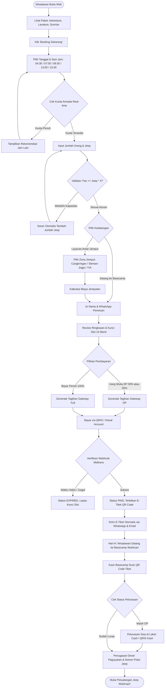
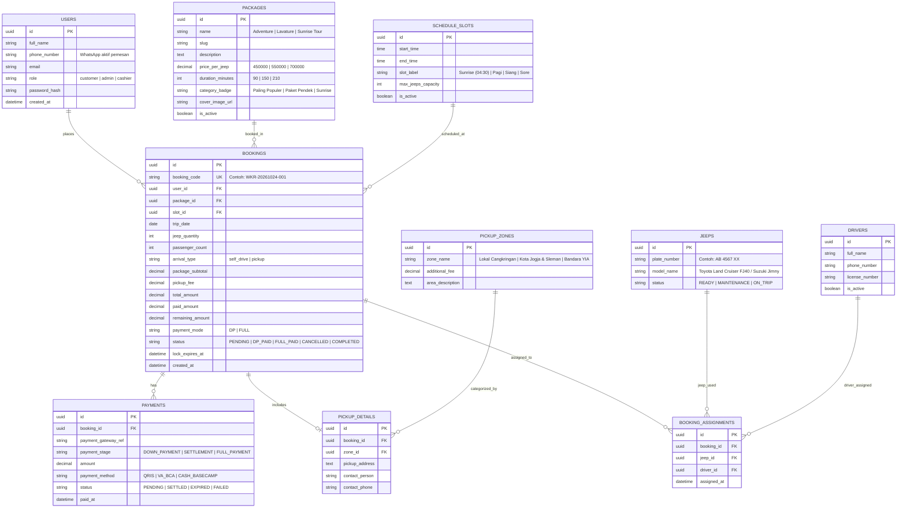

# Product Requirements Document (PRD)
## Platform Pemesanan Jeep Wukirsari Adventure Tour (Lereng Merapi, Sleman, Yogyakarta)

---

| Dokumen Versi | 1.2.0 (Penyelarasan Desain Resmi & Branding) |
| :--- | :--- |
| **Status** | Disetujui untuk Pengembangan (Development Ready) |
| **Brand Resmi** | **Jeep Wukirsari Adventure Tour** |
| **Lokasi Operasional** | Wukirsari, Kapanewon Cangkringan, Kabupaten Sleman, D.I. Yogyakarta |
| **Target Rilis MVP** | Q3 / Q4 2026 |
| **Pemilik Proyek** | Pengelola & Paguyuban Jeep Wukirsari |
| **Klasifikasi** | Dokumen Teknis & Produk Internal |

---

## 1. Ringkasan Eksekutif & Latar Belakang

### 1.1 Latar Belakang
**Jeep Wukirsari Adventure Tour** beroperasi di kawasan Wukirsari (Kapanewon Cangkringan, Kabupaten Sleman, D.I. Yogyakarta), tepat di kaki Gunung Merapi. Layanan ini menawarkan pengalaman wisata petualangan off-road menyusuri jalur lahar dingin, bebatuan vulkanik, bunker bersejarah, spot matahari terbit (*sunrise*), hingga sensasi manuver air di Sungai Kalikuning menggunakan armada tangguh Jeep 4x4 (Toyota Land Cruiser FJ40, Suzuki Jimny Katana, Mitsubishi Willys).

Untuk meningkatkan kenyamanan wisatawan dan efisiensi paguyuban, dibangun platform digital terpadu dengan desain bernuansa alam (*Lush Forest Green & Warm Cream*) yang selaras dengan citra keindahan alam lereng Merapi.

### 1.2 Tujuan Produk
1. Memfasilitasi reservasi online mandiri (*self-service booking*) melalui antarmuka web modern yang cepat dan responsif (dioptimalkan untuk pengguna smartphone).
2. Menampilkan katalog paket resmi (**Adventure**, **Lavature**, dan **Sunrise Tour**) dengan rincian durasi, fasilitas, dan harga per jeep yang transparan.
3. Menyediakan kalender ketersediaan armada *real-time* untuk mencegah penumpukan antrean atau *overbooking*.
4. Mengintegrasikan pembayaran digital otomatis (pilihan pembayaran penuh 100% atau Uang Muka / DP 30%-50%) melalui Payment Gateway (QRIS & Virtual Account).
5. Menerbitkan e-voucher QR Code instan yang dikirimkan langsung ke nomor WhatsApp wisatawan.
6. Menyediakan dasbor operasional bagi admin dan paguyuban untuk penugasan pengemudi (*driver dispatching*), scanner tiket check-in di loket basecamp, dan laporan pembukuan.

---

## 2. Rincian Paket Wisata Resmi (Sesuai Referensi Desain)

Katalog paket utama yang terpasang di sistem mengacu pada spesifikasi berikut:

| Nama Paket | Label / Badge | Estimasi Durasi | Kapasitas | Tarif Resmi | Rute & Atraksi Utama |
| :--- | :--- | :--- | :--- | :--- | :--- |
| **Adventure** | *Paling Populer* / *Paket Pendek* | 1.5 – 2.0 Jam | Maks. 4 Orang | **Rp 450.000** / Jeep | Jalur lava, Museum Sisa Hartaku, Batu Alien, dan manuver air Sungai Kalikuning. |
| **Lavature** | *Paket Sedang* | 2.0 – 2.5 Jam | Maks. 4 Orang | **Rp 550.000** / Jeep | Rute Adventure + Bunker Kaliadem & Petilasan Mbah Maridjan dengan jalur lebih menantang. |
| **Sunrise Tour** | *Paket Spesial Fajar* | 3.0 – 4.0 Jam (Mulai 04:30) | Maks. 4 Orang | **Rp 700.000** / Jeep | Menyaksikan matahari terbit di atas Gunung Merapi dari Bunker Kaliadem, udara sejuk fajar, & rute lengkap. |

---

## 3. Identitas Visual & Antarmuka Pengguna (UI/UX)

Sistem mengadopsi panduan desain dari **[DESIGN/STYLEGUIDE.md](file:///C:/xampp/htdocs/WebWukirsari/DESIGN/STYLEGUIDE.md)**:

* **Palet Warna Utama**:
  - `wukirsari-primary`: `#1E3F20` (Deep Forest Green - tombol utama, navbar badge, footer)
  - `wukirsari-dark`: `#142B16` (Latar belakang footer & banner kontras)
  - `wukirsari-sage`: `#E8EFE9` (Latar belakang bilah fitur & ikon squircle)
  - `wukirsari-cream`: `#F7F7F2` (Latar belakang canvas utama seluruh halaman)
  - `sunrise-gold`: `#F59E0B` (Aksen bintang ulasan & matahari fajar)
* **Tipografi**:
  - `Plus Jakarta Sans` / `Inter` untuk body teks, tombol, harga, dan formulir booking.
  - `Outfit` / `Plus Jakarta Sans Bold` untuk judul Display Hero & judul seksi.
  - Aksen kursif halus (*Playfair Italic*) pada sub-judul *"Petualangan di Lereng Merapi"* dan *"Mengapa Memilih"*.
* **Susunan Halaman Beranda (Landing Page)**:
  1. **Navbar**: Logo Jeep Wukirsari, Menu (Beranda, Paket Wisata, Tentang Kami, Galeri, Kontak), Tombol *"Booking Sekarang ->"*.
  2. **Hero Section**: Foto Gunung Merapi megah & Jeep 4x4 hijau, pill badge, judul hero, tombol ganda (*Booking Sekarang* & *Jelajahi Paket*), slider 01–05, pin lokasi *"📍 Wukirsari, Sleman, Yogyakarta"*.
  3. **Bilah Keunggulan (4 Fitur Bar)**: *Jeep 4x4*, *Driver Berpengalaman*, *Fasilitas Lengkap*, *Lokasi Strategis*.
  4. **Katalog Paket Wisata Populer**: 3 kartu paket (*Adventure*, *Lavature*, *Sunrise Tour*) lengkap dengan harga, durasi, dan aksi ganda.
  5. **Blok "Mengapa Memilih Jeep Wukirsari?"**: Kotak hijau gelap di kiri (*Tentang Kami ->*) dan 4 kartu fitur di kanan (*Harga Transparan*, *Pelayanan Ramah*, *Jalur Aman*, *Pengalaman Terbaik*).
  6. **Galeri Momen Indah**: Grid 5 foto dokumentasi rute lava tour.
  7. **Ulasan Wisatawan (Testimoni)**: Bintang emas 5.0, nama pemesan, asal kota, dan testimoni.
  8. **Footer**: Hijau tua dengan tautan navigasi, kontak telepon/email, dan media sosial resmi.

---

## 4. Alur Kerja Sistem yang Disempurnakan (User Flow)

---

## 5. Rancangan Skema Basis Data Relasional (ERD)

---

## 6. Fitur Administrasi & Operasional Paguyuban

1. **Manajemen Armada & Giliran Pengemudi (Dispatching)**:
   - Pengelola dapat menugaskan nomor polisi mobil dan pengemudi lokal Wukirsari ke setiap pesanan yang telah berstatus `PAID` / `DP_PAID`.
   - Sistem rotasi antrean untuk menjamin keadilan bagi seluruh anggota paguyuban.
2. **Scanner Loket Basecamp**:
   - Petugas kasir loket memindai QR Code e-voucher wisatawan saat tiba di lokasi.
   - Jika wisatawan baru membayar DP, sistem otomatis menampilkan nominal sisa tagihan untuk dilunasi (Tunai atau QRIS Loket).
   - Tombol satu klik: *"Pelunasan Diterima"*, status berubah menjadi `FULL_PAID`.
3. **Peringatan Kondisi Cuaca & Status Merapi**:
   - Tombol mitigasi darurat cuaca (*Force Majeure*): Memungkinkan admin menjadwalkan ulang (*reschedule*) atau membatalkan trip dengan pengembalian dana (*refund*) resmi jika terjadi hujan badai atau peningkatan status aktivitas vulkanik.
